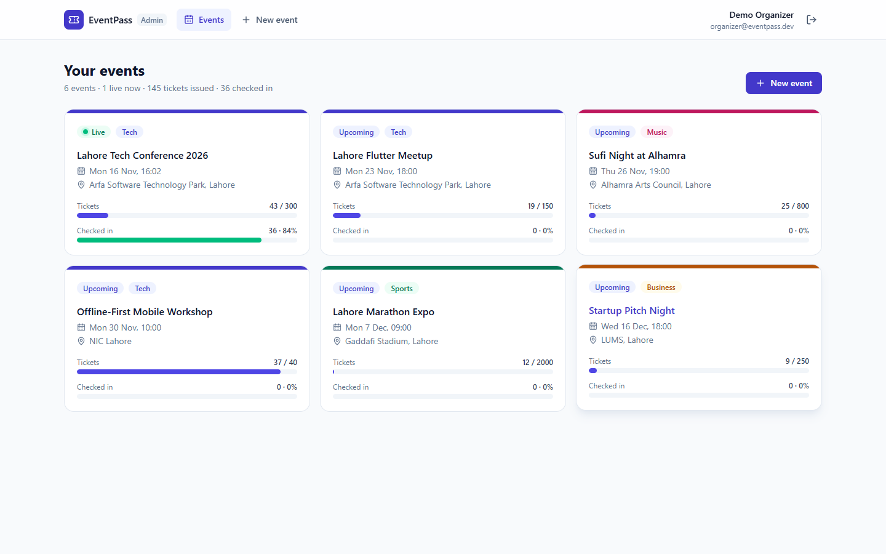
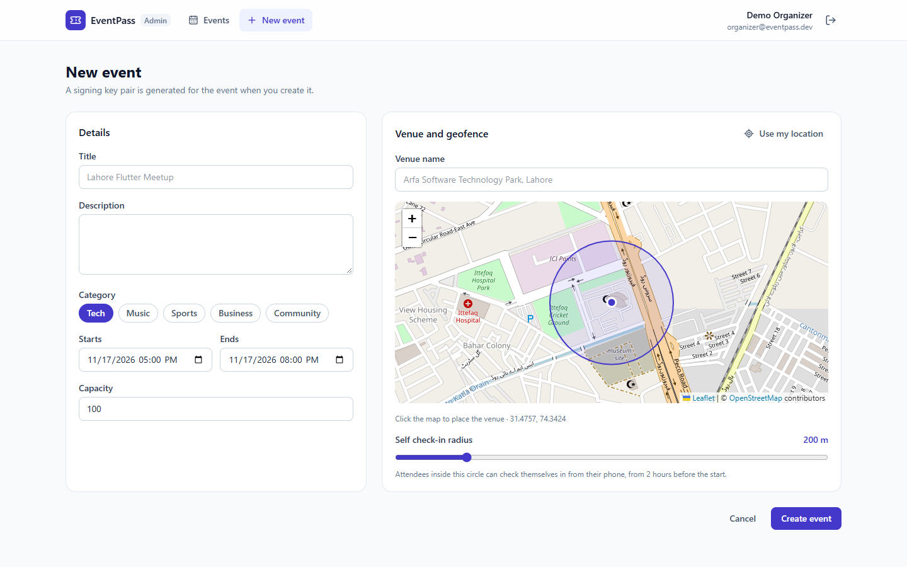
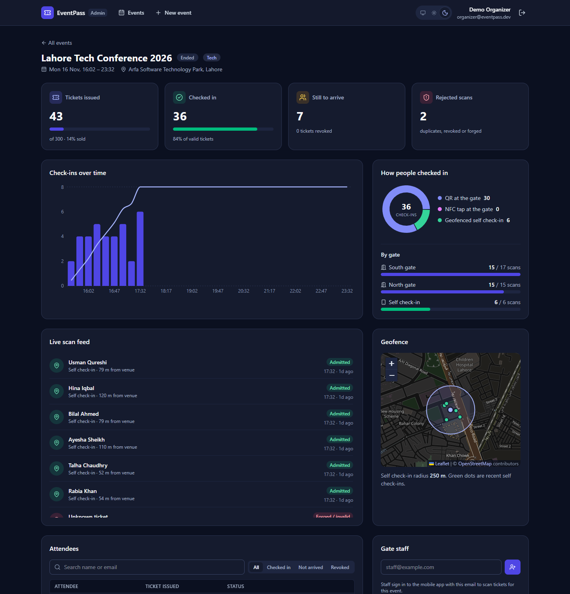
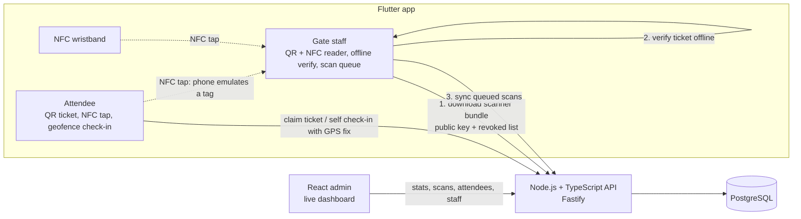

# EventPass

Event ticketing and check-in that keeps working when the venue Wi-Fi doesn't.

Attendees get a ticket signed with the event's private key. Gate staff read it as a **QR code** or with an **NFC tap** (a wristband, or the attendee's own phone acting as an NFC tag) on a phone that holds only the event's **public key**, so tickets are verified **offline**, on the phone, in milliseconds. Scans queue on the device and sync when it reconnects; the server settles conflicts, such as the same ticket scanned at two gates, deterministically. Attendees standing inside the venue's **geofence** can also check themselves in from their own phone. Organizers watch it all live on a **React dashboard**.


## What's in the repo

| Part | Stack | What it does |
| --- | --- | --- |
| [`backend/`](backend) | Node.js 24, TypeScript, Fastify 5, PostgreSQL 17 | Auth, events, Ed25519-signed tickets, scan sync, geofence check-in, dashboard APIs |
| [`mobile/`](mobile) | Flutter 3.47, Riverpod, Drift, Dio, Kotlin (NFC) | Attendee app (tickets, QR, NFC tap, self check-in) and gate scanner (QR + NFC, offline verification, sync queue), English and Urdu |
| [`admin/`](admin) | React 19, TypeScript, Vite, TanStack Query, Recharts, Leaflet, Tailwind | Organizer dashboard: create events on a map, live check-in chart, scan feed, attendees, staff |

## Features

**Attendee app**
- Browse events with search and category filters; live events in a "Happening now" carousel
- Claim a ticket (capacity can't be oversold, even under concurrent claims)
- Ticket with QR code that works with no signal (cached in SQLite)
- **Tap to check in (NFC)**: on Android the phone itself becomes an NFC ticket while the screen is open; the gate reads it like a wristband
- **Save to wristband**: write the ticket to a blank NFC wristband or sticker (NTAG215 or larger)
- **Geofenced self check-in**: one GPS fix, checked server-side against the venue radius; rejects mock locations and imprecise fixes
- English and Urdu (right-to-left)
- Light, dark or follow-the-phone theme, picked in Settings with live previews; saved on the device

**Gate scanner (same app, for staff)**
- Downloads a *scanner bundle*: the event's public key and revoked ticket ids
- **QR or NFC mode**, one tap to switch: the NFC reader accepts wristbands, stickers, cards and attendee phones
- Verifies each ticket with Ed25519 **on the phone**: forged, edited, revoked, wrong-event and already-used tickets are rejected instantly, with no network
- Animated full-screen verdicts (admitted, already used, revoked, forged) so staff can read the result at arm's length
- Every scan is written to SQLite first, then synced in the background; shows pending count and sync status
- Flags scans the server overruled (ticket already used at another gate)

**Admin dashboard**
- Events overview with sales and check-in progress
- Create an event by clicking the venue on a map and sizing the geofence
- Live dashboard (refreshes every 5 s): check-ins over time, QR / NFC / geofence split, per-gate throughput, scan feed with offline-sync delay, self check-in locations on the map
- Attendee list with search, filters and ticket revocation; add/remove gate staff
- System / Light / Dark switch in the header; the new theme spreads out in a circle from the switch, and charts and the map follow it

| Events | Create event |
| --- | --- |
|  |  |



## Architecture



## How tickets work

A ticket token is `EP1.<payload>.<signature>`:

- **payload:** base64url JSON with ticket id, event id, holder name and issue time.
- **signature:** Ed25519 over the prefix and payload, made with a key pair that is unique to each event.

The Flutter verifier is tested against a token signed by the Node backend, so both sides provably agree on the format.

### Over NFC

The NFC tag holds **the same token**, in one NDEF Text record. There are two ways to carry it:

- **Wristband or sticker:** the attendee app writes the record to a blank NTAG215+ tag (a ticket is about 270 bytes; NTAG213 is too small).
- **The attendee's phone (Android):** while the "Tap to check in" screen is open, a `HostApduService` answers the gate as a read-only **NFC Forum Type 4 Tag** (`Type4TagEmulator.kt`: SELECT the NDEF application, read the capability container, read the NDEF file in chunks). When the reader has read the last byte, the app says "Ticket sent", then polls until the gate's sync confirms the check-in.

Because the phone looks exactly like a tag, the gate reads both with the same NDEF code and verifies the token exactly like a QR code.

## Design decisions

| Decision | Why |
| --- | --- |
| Ed25519 signatures instead of a ticket lookup | Scanners verify with no network; a forged or edited QR fails the signature check. |
| One key pair per event | A leaked key affects one event, not every event. |
| Private keys encrypted at rest (AES-256-GCM) | A database dump alone can't mint tickets. |
| Device-generated scan ids | Re-uploading after a dropped connection is idempotent. |
| Partial unique index: one `accepted` scan per ticket | The database, not app code, guarantees no double entry, across gates *and* across QR vs geofence. |
| `SELECT … FOR UPDATE` on the event when claiming | Concurrent claims can't oversell capacity (tested with 8 parallel claims for 3 seats). |
| NFC carries the signed token, not an id | A tag or phone is just another way to deliver the QR string: the gate verifies it offline, and a copied tag is caught by the same one-accepted-scan rule as a screenshot of a QR code. |
| Phone emulates a standard Type 4 Tag | One reader code path for wristbands and phones, and readers on iOS and Android both understand it. Emulation is on only while the tap screen is open, and EventPass asks Android to route taps to it first. |
| Geofence decided on the server | The phone sends its fix; the server computes the distance, so the radius can't be bypassed by editing the app. Mocked locations and fixes worse than 100 m are rejected. |
| Scan locally first, sync later | The line keeps moving when the venue network is down; the server's answer is stored next to the phone's. |
| Dashboard polls every 5 s | Simpler and more robust than websockets for this load; TanStack Query handles caching and refetch. |

## API

| Method | Path | Who | Purpose |
| --- | --- | --- | --- |
| POST | `/auth/register`, `/auth/login` | anyone | Account and JWT |
| GET | `/me` | signed in | Current user |
| GET | `/events?q=&category=` | anyone | Upcoming and live events |
| GET | `/events/:id` | anyone | Event details |
| POST | `/events` | organizer | Create an event (generates its key pair) |
| POST | `/events/:id/tickets` | signed in | Claim a ticket (idempotent) |
| GET | `/me/tickets` | signed in | My tickets with QR tokens and check-in status |
| POST | `/events/:id/check-in` | ticket holder | Geofenced self check-in |
| GET | `/me/staff-events` | signed in | Events I can scan for |
| GET | `/events/:id/scanner-bundle` | staff | Public key + revoked ticket ids |
| POST | `/events/:id/scans/sync` | staff | Upload queued scans (each with `method`: `qr` or `nfc`); returns accepted / duplicate / revoked / invalid |
| GET | `/organizer/events` | organizer | My events with live counts |
| GET | `/events/:id/stats` | event organizer | Totals, timeline, method split, per-gate counts |
| GET | `/events/:id/scans` | event organizer | Live scan feed |
| GET | `/events/:id/tickets?q=` | event organizer | Attendee list |
| GET/POST/DELETE | `/events/:id/staff` | event organizer | Manage gate staff |
| POST | `/events/:id/tickets/:ticketId/revoke` | event organizer | Revoke a ticket |

## Run it locally

Requirements: Node.js 22+, PostgreSQL 15+ and Flutter 3.47+.

```bash
cd backend
npm install
cp .env.example .env      # then set your Postgres password and generate the two secrets
npm run db:setup          # creates the eventpass and eventpass_test databases
npm run migrate
npm run seed              # demo accounts, 6 events, a live event with ~40 check-ins
npm run dev               # http://localhost:3000/health
npm test                  # unit tests + end-to-end API tests against eventpass_test
```

Admin dashboard, with the backend running:

```bash
cd admin
npm install
npm run dev               # http://localhost:5173, sign in as organizer@eventpass.dev
```

Mobile app:

```bash
cd mobile
flutter pub get
flutter run               # Android emulator; see mobile/README.md for a physical phone
```

Demo accounts (password `eventpass-demo`): `attendee@eventpass.dev` (tickets, self check-in), `staff@eventpass.dev` (gate scanner), `organizer@eventpass.dev` (dashboard and scanner).

## Tests

- **Backend (Vitest, 21 tests):** token crypto, full ticket-to-check-in flow against real PostgreSQL, gate conflicts, concurrency, geofence rules, organizer authorization.
- **Mobile (flutter_test, 39 tests):** offline Ed25519 verification against a backend-signed token, scan queue and sync, overruled scans, offline ticket cache, self check-in, NDEF ticket encoding, widget tests that drive the NFC reader and tap-to-check-in screens with a fake NFC service, and switching the theme from Settings.
- **Android (JUnit):** the Type 4 Tag emulator, played through a full reader conversation (chunked reads, delivery signal, refusing other AIDs and writes).
- **Admin (Vitest):** timeline bucketing, formatting and theme selection.
- All three run in GitHub Actions on every push.

## Roadmap

- [x] Backend: auth, events, signed tickets, offline-scan sync, revocation, stats
- [x] Flutter attendee app: events, tickets, offline QR, English/Urdu
- [x] Flutter gate scanner: camera, offline verification, sync queue
- [x] Geofenced self check-in
- [x] NFC check-in: wristbands, and Android phones acting as an NFC ticket
- [x] React admin dashboard with live check-in chart
- [x] CI for backend, mobile and admin
- [ ] Deployment (API + database + dashboard) and demo video
