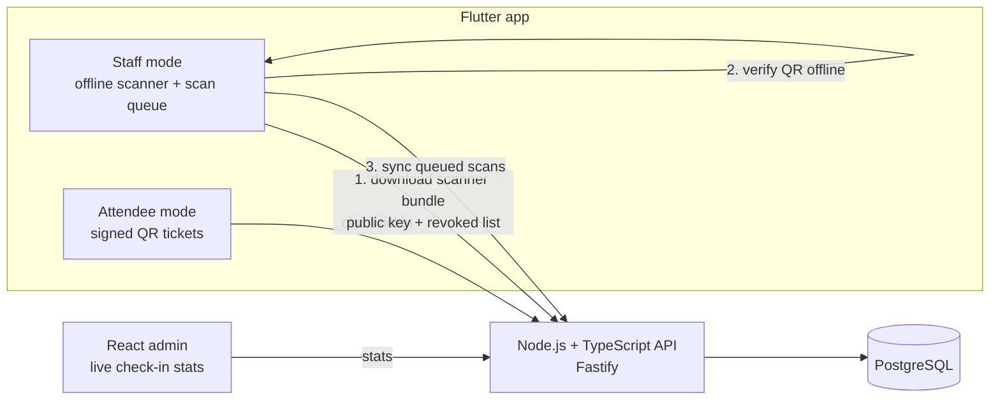

# EventPass

Event ticketing and check-in that keeps working when the venue Wi-Fi doesn't.

Attendees get a QR ticket signed with the event's private key. Gate staff scan it on a phone that has only the event's **public key**, so tickets are verified **offline** in milliseconds. Scans are queued on the device and synced when it reconnects; the server settles conflicts, such as the same ticket scanned at two gates, deterministically.

> **Status:** work in progress. The backend API is done and tested. The Flutter app and the React admin dashboard are next. See the [roadmap](#roadmap).

## Architecture



## How tickets work

A ticket token is `EP1.<payload>.<signature>`:

- **payload:** base64url JSON with ticket id, event id, holder name and issue time.
- **signature:** Ed25519 over the prefix and payload, made with a key pair that is unique to each event.

Design choices:

| Decision | Why |
| --- | --- |
| Ed25519 signatures instead of a ticket lookup | Scanners verify with no network; a forged or edited QR fails the signature check. |
| One key pair per event | A leaked key affects one event, not every event. |
| Private keys encrypted at rest (AES-256-GCM) | A database dump alone can't mint tickets. |
| Device-generated scan ids | Re-uploading after a dropped connection is idempotent. |
| Partial unique index: one `accepted` scan per ticket | The database, not app code, guarantees no double entry, even across gates. |
| `SELECT … FOR UPDATE` on the event when claiming | Concurrent claims can't oversell capacity (covered by a test with 8 parallel claims for 3 seats). |

## API

| Method | Path | Who | Purpose |
| --- | --- | --- | --- |
| POST | `/auth/register` | anyone | Create an attendee or organizer account |
| POST | `/auth/login` | anyone | Get a JWT |
| GET | `/me` | signed in | Current user |
| GET | `/events` | anyone | Upcoming events |
| GET | `/events/:id` | anyone | Event details |
| POST | `/events` | organizer | Create an event (generates its key pair) |
| POST | `/events/:id/staff` | event organizer | Add gate staff by email |
| POST | `/events/:id/tickets` | signed in | Claim a ticket (idempotent) |
| GET | `/me/tickets` | signed in | My tickets with QR tokens |
| GET | `/events/:id/scanner-bundle` | staff | Public key + revoked ticket ids for offline scanning |
| POST | `/events/:id/scans/sync` | staff | Upload queued scans; returns accepted / duplicate / revoked / invalid |
| POST | `/events/:id/tickets/:ticketId/revoke` | event organizer | Revoke a ticket |
| GET | `/events/:id/stats` | event organizer | Capacity, issued, checked in, rejected scans |

## Run it locally

Requirements: Node.js 22+ and PostgreSQL 15+.

```bash
cd backend
npm install
cp .env.example .env      # then set your Postgres password and generate the two secrets
npm run db:setup          # creates the eventpass and eventpass_test databases
npm run migrate
npm run dev               # http://localhost:3000/health
npm test                  # unit tests + end-to-end API tests against eventpass_test
```

## Roadmap

- [x] Backend: auth, events, signed tickets, offline-scan sync, revocation, stats
- [x] Tests: token crypto, full ticket-to-check-in flow, concurrency, auth and validation
- [x] CI: type check and tests against PostgreSQL 17 on every push
- [ ] Flutter app: attendee mode (tickets, QR, offline cache)
- [ ] Flutter app: staff mode (camera scanner, offline verification, sync queue)
- [ ] Geofenced self check-in
- [ ] React + TypeScript admin dashboard with live check-in chart
- [ ] Deployment and demo video

## Tech

Node.js 24 · TypeScript · Fastify 5 · PostgreSQL 17 · Zod · Vitest · GitHub Actions · Flutter (coming)
