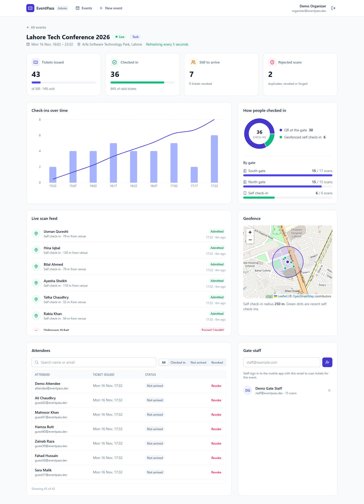
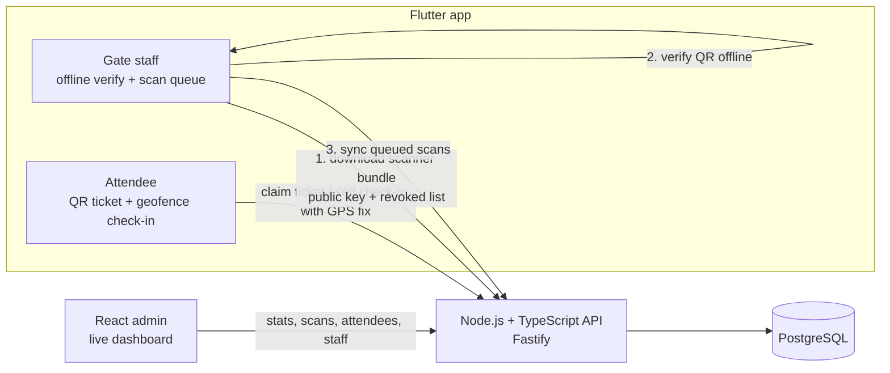

# EventPass

Event ticketing and check-in that keeps working when the venue Wi-Fi doesn't.

Attendees get a QR ticket signed with the event's private key. Gate staff scan it on a phone that holds only the event's **public key**, so tickets are verified **offline**, on the phone, in milliseconds. Scans queue on the device and sync when it reconnects; the server settles conflicts, such as the same ticket scanned at two gates, deterministically. Attendees standing inside the venue's **geofence** can also check themselves in from their own phone. Organizers watch it all live on a **React dashboard**.



## What's in the repo

| Part | Stack | What it does |
| --- | --- | --- |
| [`backend/`](backend) | Node.js 24, TypeScript, Fastify 5, PostgreSQL 17 | Auth, events, Ed25519-signed tickets, scan sync, geofence check-in, dashboard APIs |
| [`mobile/`](mobile) | Flutter 3.47, Riverpod, Drift, Dio | Attendee app (tickets, QR, self check-in) and gate scanner (offline verification, sync queue), English and Urdu |
| [`admin/`](admin) | React 19, TypeScript, Vite, TanStack Query, Recharts, Leaflet, Tailwind | Organizer dashboard: create events on a map, live check-in chart, scan feed, attendees, staff |

## Features

**Attendee app**
- Browse events with search and category filters; live events in a "Happening now" carousel
- Claim a ticket (capacity can't be oversold, even under concurrent claims)
- Ticket with QR code that works with no signal (cached in SQLite)
- **Geofenced self check-in**: one GPS fix, checked server-side against the venue radius; rejects mock locations and imprecise fixes
- English and Urdu (right-to-left)

**Gate scanner (same app, for staff)**
- Downloads a *scanner bundle*: the event's public key and revoked ticket ids
- Verifies each QR with Ed25519 **on the phone**: forged, edited, revoked, wrong-event and already-used tickets are rejected instantly, with no network
- Every scan is written to SQLite first, then synced in the background; shows pending count and sync status
- Flags scans the server overruled (ticket already used at another gate)

**Admin dashboard**
- Events overview with sales and check-in progress
- Create an event by clicking the venue on a map and sizing the geofence
- Live dashboard (refreshes every 5 s): check-ins over time, QR vs geofence split, per-gate throughput, scan feed with offline-sync delay, self check-in locations on the map
- Attendee list with search, filters and ticket revocation; add/remove gate staff

| Events | Create event |
| --- | --- |
|  |  |

## Architecture



## How tickets work

A ticket token is `EP1.<payload>.<signature>`:

- **payload:** base64url JSON with ticket id, event id, holder name and issue time.
- **signature:** Ed25519 over the prefix and payload, made with a key pair that is unique to each event.

The Flutter verifier is tested against a token signed by the Node backend, so both sides provably agree on the format.

## Design decisions

| Decision | Why |
| --- | --- |
| Ed25519 signatures instead of a ticket lookup | Scanners verify with no network; a forged or edited QR fails the signature check. |
| One key pair per event | A leaked key affects one event, not every event. |
| Private keys encrypted at rest (AES-256-GCM) | A database dump alone can't mint tickets. |
| Device-generated scan ids | Re-uploading after a dropped connection is idempotent. |
| Partial unique index: one `accepted` scan per ticket | The database, not app code, guarantees no double entry, across gates *and* across QR vs geofence. |
| `SELECT … FOR UPDATE` on the event when claiming | Concurrent claims can't oversell capacity (tested with 8 parallel claims for 3 seats). |
| Geofence decided on the server | The phone sends its fix; the server computes the distance, so the radius can't be bypassed by editing the app. Mocked locations and fixes worse than 100 m are rejected. |
| Scan locally first, sync later | The line keeps moving when the venue network is down; the server's answer is stored next to the phone's. |
| Dashboard polls every 5 s | Simpler and more robust than websockets for this load; TanStack Query handles caching and refetch. |

## API

| Method | Path | Who | Purpose |
| --- | --- | --- | --- |
| POST | `/auth/register`, `/auth/login` | anyone | Account and JWT |
| GET | `/me` | signed in | Current user |
| GET | `/events?q=&category=` | anyone | Upcoming and live events |
| GET | `/events/:id` | anyone | Event details |
| POST | `/events` | organizer | Create an event (generates its key pair) |
| POST | `/events/:id/tickets` | signed in | Claim a ticket (idempotent) |
| GET | `/me/tickets` | signed in | My tickets with QR tokens and check-in status |
| POST | `/events/:id/check-in` | ticket holder | Geofenced self check-in |
| GET | `/me/staff-events` | signed in | Events I can scan for |
| GET | `/events/:id/scanner-bundle` | staff | Public key + revoked ticket ids |
| POST | `/events/:id/scans/sync` | staff | Upload queued scans; returns accepted / duplicate / revoked / invalid |
| GET | `/organizer/events` | organizer | My events with live counts |
| GET | `/events/:id/stats` | event organizer | Totals, timeline, method split, per-gate counts |
| GET | `/events/:id/scans` | event organizer | Live scan feed |
| GET | `/events/:id/tickets?q=` | event organizer | Attendee list |
| GET/POST/DELETE | `/events/:id/staff` | event organizer | Manage gate staff |
| POST | `/events/:id/tickets/:ticketId/revoke` | event organizer | Revoke a ticket |

## Run it locally

Requirements: Node.js 22+, PostgreSQL 15+ and Flutter 3.47+.

```bash
cd backend
npm install
cp .env.example .env      # then set your Postgres password and generate the two secrets
npm run db:setup          # creates the eventpass and eventpass_test databases
npm run migrate
npm run seed              # demo accounts, 6 events, a live event with ~40 check-ins
npm run dev               # http://localhost:3000/health
npm test                  # unit tests + end-to-end API tests against eventpass_test
```

Admin dashboard, with the backend running:

```bash
cd admin
npm install
npm run dev               # http://localhost:5173, sign in as organizer@eventpass.dev
```

Mobile app:

```bash
cd mobile
flutter pub get
flutter run               # Android emulator; see mobile/README.md for a physical phone
```

Demo accounts (password `eventpass-demo`): `attendee@eventpass.dev` (tickets, self check-in), `staff@eventpass.dev` (gate scanner), `organizer@eventpass.dev` (dashboard and scanner).

## Tests

- **Backend (Vitest, 21 tests):** token crypto, full ticket-to-check-in flow against real PostgreSQL, gate conflicts, concurrency, geofence rules, organizer authorization.
- **Mobile (flutter_test, 25 tests):** offline Ed25519 verification against a backend-signed token, scan queue and sync, overruled scans, offline ticket cache, self check-in.
- **Admin (Vitest):** timeline bucketing and formatting.
- All three run in GitHub Actions on every push.

## Roadmap

- [x] Backend: auth, events, signed tickets, offline-scan sync, revocation, stats
- [x] Flutter attendee app: events, tickets, offline QR, English/Urdu
- [x] Flutter gate scanner: camera, offline verification, sync queue
- [x] Geofenced self check-in
- [x] React admin dashboard with live check-in chart
- [x] CI for backend, mobile and admin
- [ ] Deployment (API + database + dashboard) and demo video
